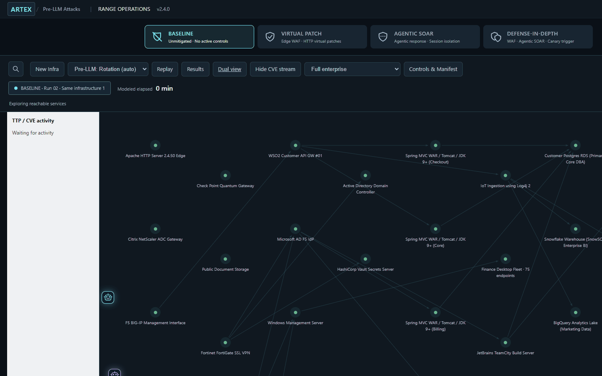

# ARTEX Attack and Defense Demo

An interactive visual demonstration of an attacker moving through an enterprise environment and the potential effects of layered defenses. The wire diagram shows a generated infrastructure, representative attack paths, vulnerability details and a rolling stream of SOC tickets.

The demo is illustrative: its infrastructure, access paths, alerts and defense outcomes are generated for presentation. They are not observations of a real environment or measurements of a product's effectiveness.



*Latest demo above: Full Enterprise overview, directional attack-flow arrows, live TTP / CVE activity stream, 3-agent ARTEX vs. Pre-LLM comparison across the four defense modes, and calibrated timing and dataset volume evidence.*


*Original demo above: classic single-canvas view ([assets/wire_current_demo.gif](assets/wire_current_demo.gif)).*

[Watch the v2 ARTEX versus Pre-LLM animation](assets/ARTEX_vs_PreLLM_v2.gif): eight runs across the four defense options, with moving attacker/agent markers and the modeled stopwatch. [Scenario and capture notes](docs/v2-animation.md).

[Watch the full 54-asset infrastructure recording](assets/ARTEX_vs_PreLLM_full_estate.gif): the entire estate stays visible from the start across eight comparisons. See [current tool state and backend validation](docs/current-tool-state.md) for random generation, logical connections, canary visibility, verification evidence and remaining model limits.

## Get and start the demo

Clone the current repository:

```powershell
git clone https://github.com/kostchei/artex_sandbox.git
cd artex_sandbox
```

On Windows, install Python 3 and make sure `python` or the Python launcher `py` is available on your PATH. Then double-click **`start.bat`** in the repository folder, or run it from PowerShell:

```powershell
.\start.bat
```

The batch file runs `start.py`, which starts a local HTTP server and opens [http://localhost:8080/wire.html](http://localhost:8080/wire.html) in your browser. Keep the launcher window open while using the demo; press **Ctrl+C** in that window to stop it.

If port 8080 is already in use, the launcher opens the existing service at that address rather than starting another server. If neither `python` nor `py` is available, `start.bat` attempts to open that address but does not start a server.

On macOS or Linux, run `./start.sh` from the repository folder. It looks for `python3` and then `python`.

## Demo branches

- **`main`** runs the demo on the full wire diagram. The site root and old Table View address (`/index.html`) redirect to `/wire.html`.
- **`wire-combined`** preserves the demo before that change, including the standalone Range Operations dashboard and the original **Compare Combined** toggle. Use this branch to revisit that version.

## Run the wire diagram

1. Use the header toggle to choose **ARTEX** or **Pre-LLM Attacks**, and optionally pick a specific pattern from the **Pre-LLM** dropdown (which defaults to **Pre-LLM: Rotation (auto)** across the nine pre-2023 attack patterns and RaaS examples: **LockBit**, **Conti**, **BlackCat**, **Hive**, **REvil · Kaseya VSA**, **APT29 · SolarWinds**, **DarkSide · Colonial VPN**, **Log4Shell · Log4j**, or **Cl0p · MOVEit Transfer**). In rotation mode, each new estate draws one pattern in randomized order and keeps that selection for replay and defense comparisons; picking a specific Pre-LLM path pins that pattern and switches the active attacker view to **Pre-LLM Attacks** on the current estate. Nominal path-duration assumptions are **80–270 minutes** for conventional examples and **45–75 minutes** for ARTEX-like. Actual completion includes queued work. These illustrative ranges are not measured breach-time distributions; see [timing assumptions and historical sources](docs/timing-assumptions.md). ARTEX-like uses three workers and conventional profiles use one.
2. Start with **Baseline**, then compare **Virtual Patch**, **Agentic SOAR**, and **Defense-in-Depth** for virtual patching + SOC + canary together. Changing the attacker or defense replays the same topology.
3. Use **Replay** to repeat the run or **Results** to jump to its outcome. The **Modeled elapsed** clock advances from the first modeled probes. Open **Timing and data volumes** inside **Controls & Manifest** to see the milestones and counts recorded so far, alongside [historical references and their limits](docs/wire-timing-and-volume.md).
4. Use **Hide CVE stream** / **Reveal CVE stream** to collapse or restore the TTP / CVE activity panel beside the diagram. **Dual view** opens Pre-LLM and ARTEX side by side on the same estate. Use the **Archetype** selector (`enterprise-identity`, `public-web`, `cloud-saas`, `cicd-secrets`) and **Controls & Manifest** panel to toggle independent defense switches (`virtualPatching`, `canaries`, `responsePolicy`), switch between `authored_walkthrough` and `exploratory` generation modes, inspect causal "Why" details on any node, or save and restore the exact displayed run with a playback manifest.
5. Choose **Full enterprise** in the archetype picker to see employee systems, public apps, cloud workloads, and software delivery on the same estate. The overview shows selected service links from the start. Findings, credentials, and attack activity appear during playback. **Authored walkthrough** uses the public web scenario on this larger estate. **Exploratory** uses the same estate type without planting that path.
6. Use **New Infra** to generate a fresh topology and a different mix of five to seven appliance families from the [Layer 1 appliance pool](docs/wire_diagram_logic.md#layer-1-appliance-pool). Authored walkthroughs include a validated route to a sample dataset. Exploratory runs use the generated conditions. Credential exposure in logs can appear as an opening.

### Why ARTEX is faster

A conventional attack is one human operator at a keyboard. ARTEX is three LLM agents running in a shared harness. The model reflects this in two ways:

- **Faster steps.** The displayed clock uses a shorter nominal path duration for ARTEX-like. Timing is a presentation assumption applied after the engine determines access and response outcomes.
- **Three agents sharing state.** Access, credentials and footholds that one agent obtains are immediately available to the others, and the three work in parallel. On a single straight path this saves no time. It pays off when routes branch, fail or are blocked: ARTEX tries alternatives concurrently while the human works through them one at a time.

**New Infra** draws from 100 CISA KEV and CTID references. Each entry selects one of four representative infrastructure profiles, and the remaining topology is generated around it. The simulation shows which generated services were reached or defended. See the [JSON catalog](assets/wire-defense-catalog.json).

The estate may also contain an exposure from the [external misconfiguration pool](docs/wire_diagram_logic.md#external-misconfiguration-pool). The replay identifies the exposed service and the access established there.

## Scenarios

| Scenario | What the demo shows |
| --- | --- |
| **Baseline** | The Schema v4 causal engine (`simulateScenario` + `projectRun`) evaluates reachability, capabilities, weaknesses, and scoped credentials. Either profile can read or export sensitive datasets when the estate supplies a viable path. |
| **Virtual Patch** | Inline WAF enforcement points block requests only when the traversed route is covered, the protocol/fields are inspectable, and an active rule matches the modeled action variant. |
| **Agentic SOAR** | Deployed sensors emit observations into the SOC investigation and response lifecycle. Response policy (`observe_only`, `playbook`, `human_led`, `agentic`), integration authority, session/token lineage, and explicit intervention contracts determine whether a scoped response is confirmed before a dependent action. |
| **Defense-in-Depth** | Route-scoped virtual patching, explicit canary decoys/honeytokens, and the SOC response lifecycle together. Qualifying decoy contact delivers attributed alert evidence to the SOC rather than automatic containment. |

WAF coverage, sensor deployment, intervention contracts, and display timings are explicit scenario assumptions recorded in [`assets/calibration.json`](assets/calibration.json).

## Infrastructure and tickets

The diagram spans internet-facing access, gateways and security controls, internal applications, and data stores. Assets occupy staggered lanes within trust layers, with space reserved for callouts; dense estates scroll vertically and narrow screens can scroll horizontally. Untouched assets use quiet green dots; successful attacks use pink halos, animated directional attack-flow arrows (mid-wire chevrons and halo-cleared arrowheads pointing from source to target), and visible CVE/technique callouts. Amber marks prevention, cyan marks confirmed containment, and gold marks decoy alerts, with text labels explaining each state. Click or keyboard-focus an asset to reveal its directional connections, dataset inventory/read/export volumes, and causal **"Why"** inspection details (prerequisites, reason codes, controls, and scope); the magnifier searches asset names, products and CVEs. ARTEX-like uses up to three concurrent workers; conventional profiles use one. Every defense configuration shares identical action-attempt and guardrail budgets; label density never limits modeled access, and sensitive impact is determined by dataset classification rather than diagram layer. Pending work at a guardrail ceiling is reported as incomplete, including when a read has already occurred.

The top strip presents the four reference defense cards (**Baseline**, **Virtual Patch**, **Agentic SOAR**, **Defense-in-Depth**), while **Controls & Manifest** lets you toggle any independent combination of **Virtual patching**, **Canaries** (including standalone canary and SOC-plus-canary modes), **Response policy** (`Observe only`, `Playbook`, `Human-led`, `Agentic`), and **Generation mode** (`Authored walkthrough` vs. `Exploratory`), or export and re-import deterministic playback manifests.

The HUD distinguishes dataset impact, data exfiltration, endpoint encryption/persistence, conditional outcomes, incomplete exploration, and partial or complete session containment. A missing read alone does not earn containment styling. Steps suppressed by effective containment do not count as new blocked attack attempts. Replay preserves the scenario and modeled event history; New Infra generates a new scenario.

An environment may include one network-monitoring system, selected from Cacti, LibreNMS, SolarWinds NPM, Zabbix, PRTG and ManageEngine OpManager. The selection has a 90% inclusion chance before topology filtering. Some products have a mapped historical CVE; others have no CVE assigned.

The SOC tickets are illustrative, generated as activity occurs. A node can produce one or several tickets, with a title, severity and short alert description. Severity and breach detection are demonstration choices, not CVSS scores or actual SIEM findings. Remediation tickets appear when a modeled virtual patch, SOC response or canary triggers.

See [current tool state and verification](docs/current-tool-state.md), [engineering specification](docs/wire-improvement-engineering-spec.md), [timing and data volumes](docs/wire-timing-and-volume.md), [wire diagram logic](docs/wire_diagram_logic.md), [Pre-LLM vs. ARTEX comparison notes](docs/pre-llm-vs-artex-comparison.md), and the [threat matrix](docs/cisa_kev_threat_matrix.md) for full model contracts and vulnerability background.

## Testing

The simulation runs headlessly under Node, so most suites need nothing beyond Node.js. Install the one dependency once, then run everything:

```powershell
npm install
npm test
```

`npm test` runs every `scripts/test-*.cjs` suite and reports each result. The browser suites drive Microsoft Edge through `playwright-core`; set `EDGE_PATH` if Edge is not at its default Windows location. To run only the headless model suites, use `npm run test:model`.

## License

[GNU Affero General Public License v3.0 (AGPL-3.0)](LICENSE).
